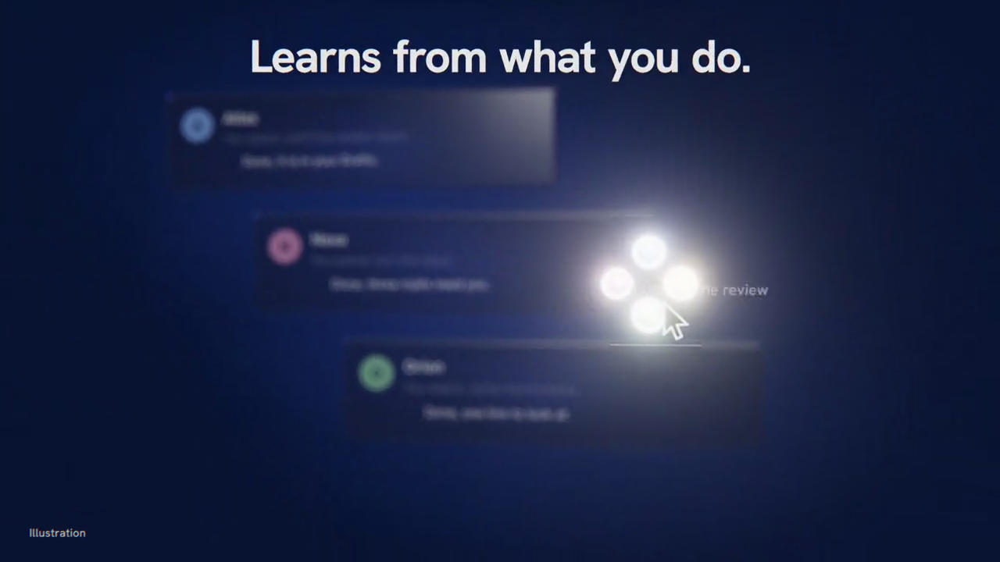

# OS-intent

**Votre Mac apprend ce que vous faites ensuite et le met à une touche.**

[](docs/media/os-intent-demo.mp4)

[▶ Voir le film (1:38)](docs/media/os-intent-demo.mp4)


OS-intent observe votre façon de travailler (en local), prédit votre prochaine action et l'affiche dans une petite
croix d'options autour du pointeur. Une pression sur une touche modificatrice suffit. Maintenez, et il descend
d'un niveau : répondre, rédiger, transférer, fusionner, passer la main à un agent, en un seul geste. Quand quelque
chose change pendant que vos mains ne touchent pas la souris (un mail client, un agent qui vous attend, un nouveau
fichier, une réunion qui commence), il le remarque et vous dit pourquoi c'est important. Chaque choix, chaque refus
et chaque souhait l'entraîne : la prochaine fois, la réponse est déjà sous votre doigt.

*[Read in English](README.md)*

| | |
|---|---|
|  |  |
| *⌥⌘ : quatre prochaines étapes, une touche chacune* | *Maintenez ⌥⌘ et glissez : les suites s'ouvrent* |
|  |  |
| *Posez-vous sur une direction : de quoi il s'agit, et pourquoi ça compte* | *Quelque chose a changé : l'indice porte un anneau* |

> Les images sont rendues hors écran à partir des vraies vues du HUD, sur un faux bureau (tous les noms sont
> fictifs) ; le kit du film est dans `docs/film/`.

---

## Les touches

| Touche | Effet |
|---|---|
| **⌥⌘** (pression ensemble) | Ouvre la croix au pointeur avec les meilleures options |
| **fn** = 1 · **⌃** = 2 · **⌥** = 3 · **⌘** = 4 | Lance l'option à la place de la touche : fn à gauche, ⌃ en haut, ⌥ à droite, ⌘ en bas |
| **⌥⌘** maintenu | **Glisser** : posez-vous sur une option, ses suites apparaissent autour et une carte dit de quoi il s'agit ; relâchez pour lancer |
| appui long sur une touche | La variante assistée par Claude : brouillon de réponse enregistré sur place dans les Brouillons de Mail (jamais envoyé), résumé en 3 lignes |
| **⇧** (croix visible) · **⌥`** (à tout moment) | **Souhait** : tapez ou dictez ce que vous vouliez ; il devient une action, ou un manque dont il apprend |
| **⌃⌥** (pression ensemble) | **Vocal** : une touche choisit l'agent, vous parlez (ou tapez), le message part après votre validation |
| **Échap** | Ferme. Taper ou s'éloigner vite ferme aussi ; rien ne vole le focus : seule une action choisie (une app, une fenêtre de réponse vide, *Open in Mail*) passe son app au premier plan |

Touches, places et couleurs se règlent dans la barre des menus (*Hotkeys…*). La couleur suit la touche :
fn rose, ⌃ bleu, ⌥ jaune, ⌘ vert.

## Fonctionnalités

### Prédire la prochaine étape

Changements d'appli, pages Safari, bureaux (Spaces), raccourcis ⌘, captures d'écran et boutons cliqués deviennent
un flux de *jetons d'action*. Un modèle propre à vous (Markov d'ordre 2 sur votre historique, et en option un petit
modèle de langage local, Laya, en ombre) classe ce qui vient d'habitude ensuite *dans ce contexte*.

**Points d'indice.** Quand le contexte change et que le modèle est sûr de lui, OS-intent n'ouvre pas de menu : il
affiche **quatre petits points colorés** près du pointeur. Ignorez-les, ils s'effacent. **⌥⌘** les déploie en croix.

**Jour 1, puis jour 30.** `oi onboard` (barre des menus → *Onboarding…*) construit un profil et un catalogue de
départ de 15 à 30 actions contextuelles à partir de ce que vous autorisez (votre mémoire Claude, vos notes, vos
mails récents, Notion, vos applis) : le HUD est utile avant tout historique. L'usage réel prend ensuite le relais.

### Glisser, avec des cartes de contexte

Maintenez ⌥⌘ : la croix reste en place. Posez-vous sur **Répondre à Sam** : *Brouillon : vendredi 10 h ok*,
*Brouillon : vendredi 14 h*, *Demander le deck à Orion*. Chaque niveau agit **dans** son parent (Finder → dossiers
récents → fichiers ; Telegram → les conversations qui vous attendent ; Musique → playlists → titres ; un site → les
pages du jour + résumé ; Mail → réponse / transfert / brouillons).

Pendant le glissé, une **carte de contexte** dit de quoi parle la direction. Niveau 2, un coup d'œil : une ligne
(*Sam Rivera · revue de jeudi · 10:31*). Restez un peu plus pour le niveau 3, une carte plus large à lire : un
résumé de 3-4 lignes, un extrait cité, et **pourquoi c'est important** : la page de votre propre base de
connaissances qui nomme l'expéditeur ou le projet.

### Claude, sur votre abonnement

Un appui long sur la touche d'une option : un anneau se remplit, Claude rédige la réponse ou le transfert dans
Mail avec le contexte du fil, ou écrit un résumé de 3 lignes. Quand le mail propose des horaires, la réponse
choisit un créneau libre de votre calendrier (lu en local, libre / pris seulement, jamais un titre). Le brouillon est enregistré **sur place** dans les
Brouillons (Mail reste derrière, pas de changement de bureau) et affiché sur la carte ; *Open in Mail* l'ouvre à la
demande. Les brouillons ne sont jamais envoyés. Claude
tourne sans interface via votre CLI Claude Code connectée ; coupez-le, tout le reste fonctionne.

### Indices proactifs : il remarque quand quelque chose change

Des capteurs locaux, à activer un par un, lisent un **état**, jamais une minuterie : un nouveau mail non lu
(jusqu'à lecture ou réponse), un agent IA qui vous attend sur Telegram (jusqu'à ce que vous lisiez ou répondiez),
un nouveau fichier dans un dossier choisi (jusqu'à ouverture ou suppression), une réunion qui commence (jusqu'à sa
fin), une pull request qui attend votre revue ; en option votre propre tableau de bord et des flux locaux de
métriques ou de marchés. Quand l'un commence, les points reviennent avec un fin **anneau** ; ⌥⌘ déploie les actions
de cet événement. Quand l'état prend fin, l'indice disparaît.

**Un seul juge de pertinence.** Chaque événement est pesé contre votre **base de connaissances** : un dossier local
de pages markdown (`OI_WIKI_DIR`, par défaut `~/wiki`), indexé par `tools/wiki/wiki_search.py` avec des embeddings
locaux (Ollama `nomic-embed-text`) et la recherche plein texte SQLite. Un mail dont l'expéditeur nomme une page de
client actif est *important* : il ouvre directement la croix, et sa carte montre cette page.

**Les agents qui vous attendent.** OS-intent lit le badge Telegram et, quand la liste des conversations est
lisible, qui a écrit ; pour les agents qui tournent sur ce Mac, il lit aussi leur propre trace locale de ce qu'ils
vous ont envoyé. La direction Telegram liste alors les conversations en attente, un clic chacune.

### Vocal et captures vers un agent

**⌃⌥** transforme la croix en sélecteur d'agents. Choisissez-en un : le panneau d'enregistrement affiche la
transcription en direct, sur l'appareil, jusqu'à 5 minutes avec un compte à rebours à la fin. Commencez à taper :
le micro s'arrête, ce qui a été entendu reste, vous corrigez. Le panneau de validation peut **joindre une capture
de l'écran**. Une capture ⌘⇧4 propose *→ Atlas*, *→ autre*, *Annoter*, et des actions lues dans l'image par OCR
local (ajouter la réunion au Calendrier, rédiger une réponse, ouvrir le lien).

### Actions de page, et rien ne sort sans votre accord

Dans Safari, les boutons de la page deviennent des options (par exemple *Squash and merge* sur GitHub) ; le HUD
retrouve le bouton par son rôle et son libellé au moment d'appuyer. Les boutons destructeurs (fermer, supprimer…)
ne sont jamais proposés. **La porte de sortie** : toute action qui quitte votre Mac (un vocal, une capture, une
réponse, un bouton de page qui n'est pas connu en lecture seule) attend un petit panneau de validation. Entrée
valide ; Échap, un clic à côté, le délai ou l'absence de HUD annulent. Jamais d'envoi automatique.

### Interrupteur Laya et santé

- **Laya on / off** depuis la barre des menus : coupé = Markov seul, le serveur du modèle local (~3 Go) est arrêté
  et sa mémoire libérée.
- **`oi health`** : chaque capteur actif (ok, en échec, ou « Mail fermé » à titre d'information), les LaunchAgents,
  les erreurs récentes des journaux, Laya. Un capteur qui ne peut pas lire est une panne, jamais « rien ».

## Confidentialité

Tout tourne sur votre Mac, sauf les appels Claude : **ils sont ACTIVÉS par défaut** (première ligne ci-dessous) et
vous pouvez les couper.

| Capteur / partie | Ce qu'il lit | Ce qu'il ne lit jamais | Pour le couper |
|---|---|---|---|
| **Claude (`claude.enabled`, `claude.enrich` : tous deux ACTIVÉS par défaut)** | lors d'un appui long, d'un glissé (suites et résumés des cartes de niveau 3, préchargés à l'ouverture de la croix), de l'enrichissement des libellés, d'un événement proactif sur lequel vous restez, des actions sur une capture et d'un souhait non résolu en local, le contexte du HUD est envoyé à **votre propre `claude -p` (Anthropic, sur votre abonnement)** : appli au premier plan, site, le mail ou message concerné, pour un résumé de page le titre, l'URL et le texte de la page Safari, le texte OCR d'une capture, et le paquet de contexte (agents, actions récentes, notes correspondantes de la base) | tout ce qui relève de `claude.local_only_domains` (« détails masqués ») | barre des menus → *Settings* → *Claude* : décochez *Claude variant* et *Enrich options with Claude*, ou `"claude": {"enabled": false, "enrich": false}` dans settings.json |
| ActivityWatch | appli au premier plan, titre de fenêtre, inactivité | contenu, frappes | barre des menus → *Pause* ; liste d'exclusion |
| oi-watcher | Spaces, raccourcis ⌘ (modificateur + touche, pas le texte), URL de l'onglet Safari, état des captures, libellé du bouton cliqué, noms et dates des nouveaux fichiers des dossiers choisis | texte tapé, texte du presse-papiers, pixels de l'écran, contenu des fichiers, fenêtres privées | *Pause* ; `shots.enabled` ; `proactive.sources.files` |
| Mail | les 8 derniers messages de la boîte de réception : id, expéditeur, objet, date, lu / répondu (AppleScript, seulement si Mail est ouvert ; ne marque rien) | le corps (lu seulement pour une carte de niveau 3 que vous demandez) | Réglages → Proactive → Mail |
| Agents | le badge du Dock de Telegram, titres et compteurs des conversations (Accessibilité), la trace locale des agents configurés | le texte des messages (sauf carte de niveau 3 demandée) | Réglages → Proactive → Agent messages |
| Calendrier | réunions à venir : titre, heure, noms des participants, lien de connexion sans ses paramètres | les notes | Réglages → Proactive → Upcoming meetings |
| Créneaux du brouillon de réponse | seulement quand un mail auquel vous répondez (appui long) propose des horaires : libre / pris de ces créneaux (EventKit, lecture seule) ; les lignes « Fri 23/10 10:00-11:00: free » vont dans le prompt Claude de cette réponse | titres, participants, notes, tout autre horaire | retirer l'accès Calendriers (Réglages Système → Confidentialité et sécurité → Calendriers) : le brouillon est fait sans |
| Pull requests | `gh` (votre session) en lecture seule | — | Réglages → Proactive → Pull requests |
| Base de connaissances | votre dossier markdown, indexé en local | tout ce qui est hors de ce dossier | ne pas la configurer |
| Onboarding | seulement les sources acceptées, une fois ; noms et comptes, jamais de documents | chemins secrets (`.ssh`, `*.env`, trousseaux…) | ne pas le lancer ; `--offline` pour le questionnaire court |

- **Toutes les sources proactives sont COUPÉES par défaut** (`proactive.sources` dans
  `~/.local/share/os-intent/settings.json`, ou Réglages → Proactive). Heures calmes et mode Concentration respectés.
- **Données locales** dans `~/.local/share/os-intent/` (0700, fichiers 0600), hors du dépôt. Les journaux ne
  contiennent jamais un nom, un objet, un chemin ou un message.
- **`local_only_domains`** : les domaines et sites listés n'atteignent jamais un modèle.
- **Claude uniquement via votre abonnement** (`claude -p` sans interface) ; clés d'API et jetons retirés de
  l'environnement.
- **Liste d'exclusion** : les gestionnaires de mots de passe ne produisent que « appli activée ».

## Installation

Prérequis : **macOS 14+** (Liquid Glass sur macOS 26+), la **chaîne Swift 6** (Xcode ou les Command Line Tools),
**Python 3.12**, **[ActivityWatch](https://activitywatch.net)** lancé. En option : la CLI Claude Code (connectée),
**Ollama** avec `nomic-embed-text` pour la base de connaissances, un dépôt local
**[Laya](https://huggingface.co/convaiinnovations/laya)** (`OI_LAYA_DIR`), `gh` (connecté) pour les pull requests.

```sh
git clone https://github.com/vdk888/os-intent.git && cd os-intent
python3.12 -m venv .venv && .venv/bin/pip install -e '.[dev]'
scripts/make-signing-identity.sh
watchers/oi-watcher/install.sh && hud/install.sh && menubar/install.sh && live/install.sh
(cd ocr && swift build -c release)                  # OCR local (optionnel)
laya/install.sh                                     # optionnel, OI_LAYA_DIR d'abord
export OI_WIKI_DIR=~/wiki && python3 tools/wiki/wiki_search.py --reindex   # optionnel
.venv/bin/oi onboard && .venv/bin/oi health
```

Autorisez ensuite, quand macOS le demande : Surveillance de l'entrée, Accessibilité, Automatisation (Safari, Mail,
System Events), Reconnaissance vocale + Micro (sur l'appareil), Calendriers (capteur de réunions, et créneaux libres / pris des horaires proposés par un mail pour son brouillon de réponse ; lecture seule, accordé une fois). La
barre des menus indique ce qui manque. Vos agents, sources, dossiers et domaines se règlent dans `settings.json`
(détails dans `docs/DESIGN.md`, commandes dans `docs/CLI.md`).

## Architecture

Voir le schéma et le tableau des dossiers dans le [README anglais](README.md#architecture).

## Statut

Prototype fonctionnel. macOS uniquement.

## Licence

MIT. Voir [LICENSE](LICENSE).
