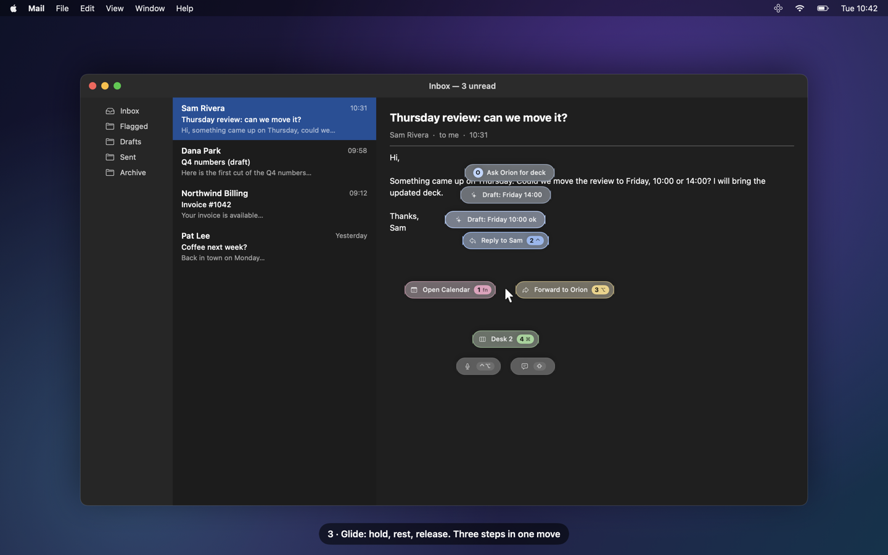
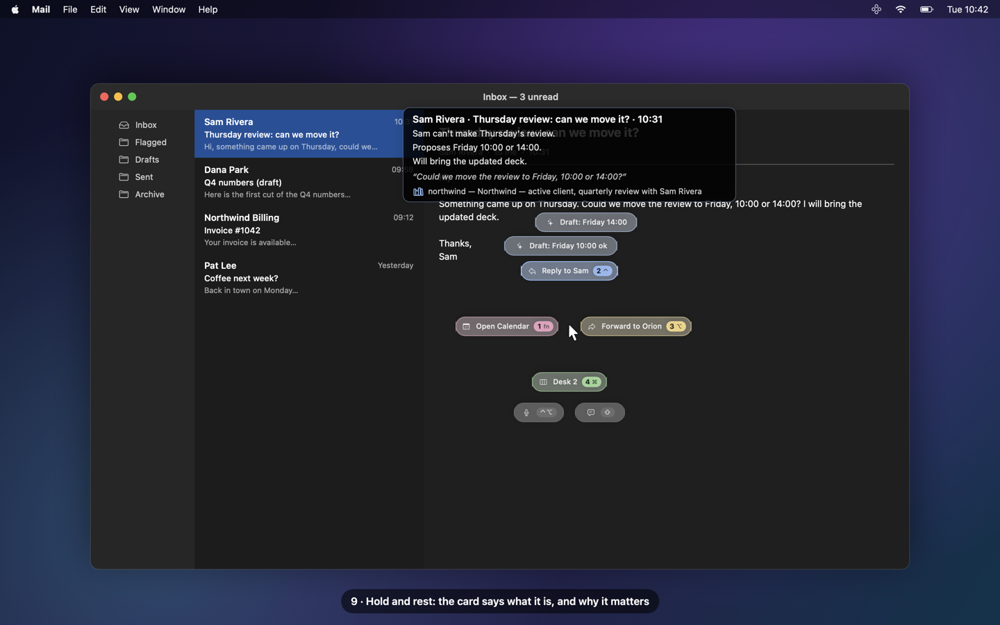
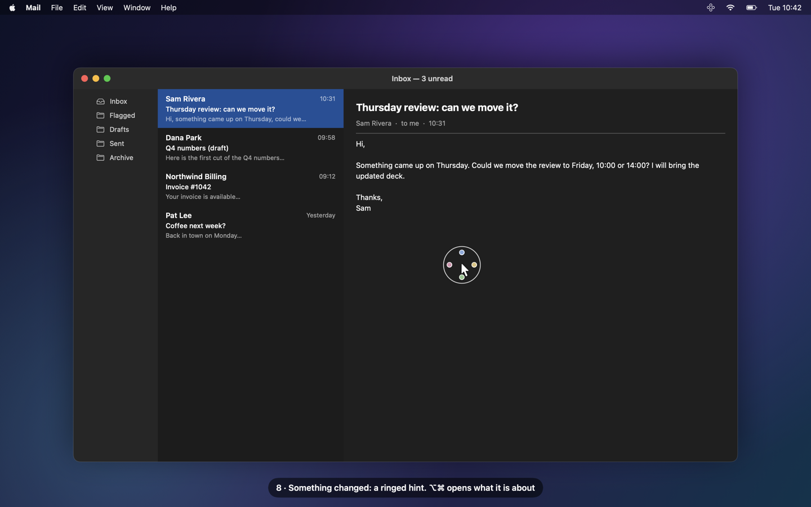
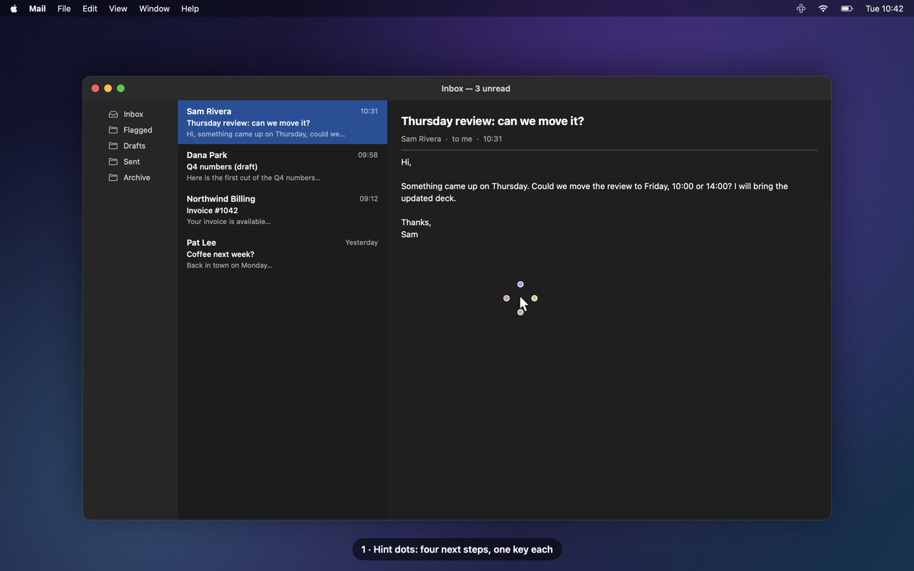
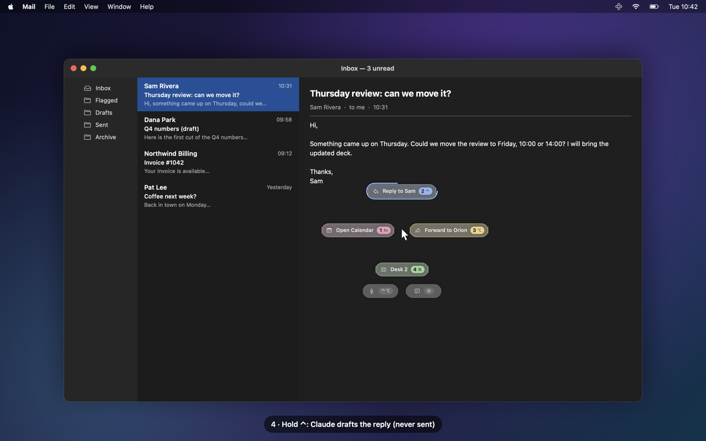
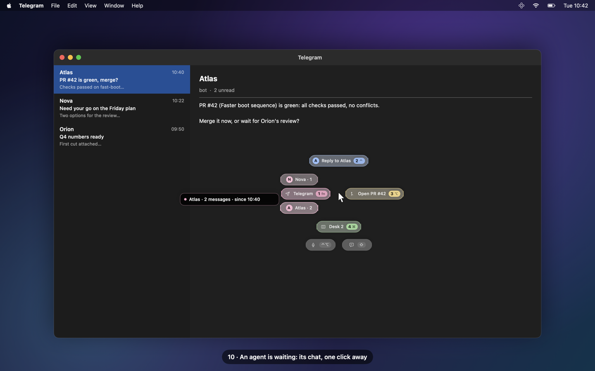
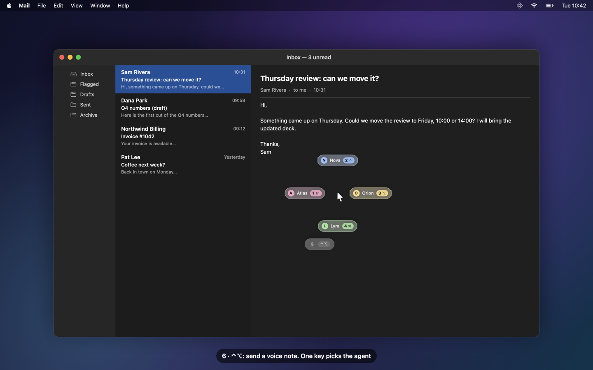
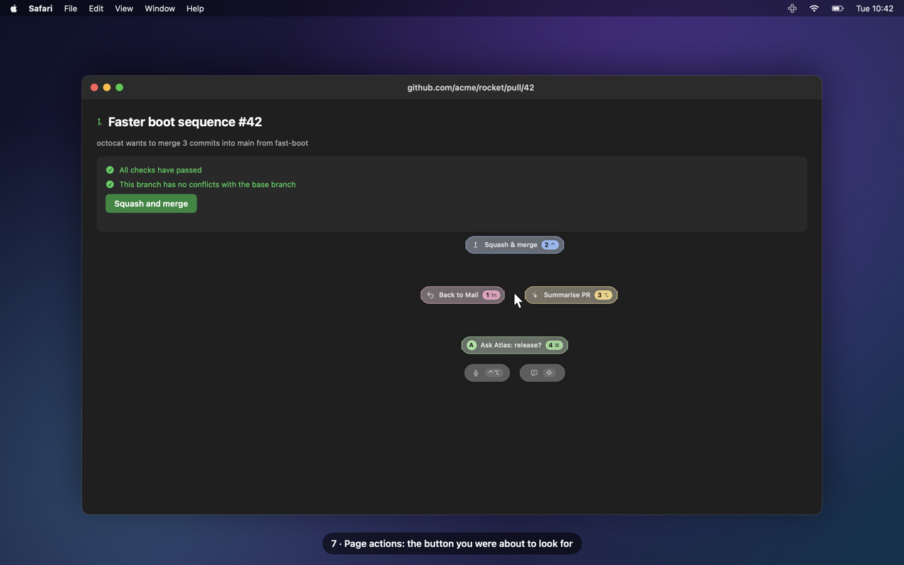

# OS-intent

**Your Mac learns what you do next and puts it one key away.**

OS-intent watches how *you* work (locally), predicts your next move, and shows it as a tiny cross of options
around your pointer. One modifier tap does it. Hold, and it drills down: reply, draft, forward, merge, hand off
to an agent, in one gesture. When something changes while your hands are off the mouse (a client mail, an agent
waiting on you, a new file, a meeting about to start), it notices, and tells you why it matters. Every press,
dismissal and wish teaches it: the next time the same moment comes back, the answer is already under your finger.

*[Lire en français](README.fr.md)*

| | |
|---|---|
|  |  |
| *⌥⌘: four next steps, one key each* | *Hold ⌥⌘ and glide: the follow-ups bloom* |
|  |  |
| *Rest on a direction: what it is about, and why it matters* | *Something changed: the hint wears a ring* |

> The stills are rendered offscreen from the real HUD views over a fake desktop (every name is fictional);
> see `docs/film/` for the film kit.

---

## The keys

| Key | What happens |
|---|---|
| **⌥⌘** (tap, together) | **Summon**: the cross opens at the pointer with the current best options |
| **fn** = 1 · **⌃** = 2 · **⌥** = 3 · **⌘** = 4 (tap) | Run the option at that key's place: fn **left**, ⌃ **top**, ⌥ **right**, ⌘ **bottom** |
| **⌥⌘** (hold ≥ 250 ms) | **Glide**: rest on an option, its follow-ups bloom around it (up to 3 levels) and a context card says what it is about; release on one to run it, on empty space to cancel |
| long-press an option's key | The **Claude-assisted variant**: a drafted reply / forward saved to Mail's Drafts in place (never sent), a 3-line summary card |
| **⇧** (HUD visible) · **⌥`** (any time) | **Wish**: type or dictate what you wanted; it is resolved to an action, or noted as a miss to learn from |
| **⌃⌥** (tap, together) | **Vocal**: pick an agent with one key, speak (or type), it lands in that agent's inbox after you confirm |
| **Esc** | Dismiss. Typing or moving away fast also dismisses; nothing steals focus: only an action you pick (an app, a plain reply window, *Open in Mail*) brings its app forward |

Every key, place and colour is configurable (menu bar → *Hotkeys…*). Colours follow the key, so they never move:
fn pink, ⌃ blue, ⌥ yellow, ⌘ green.

## Features

### Predict the next step

App switches, Safari pages, desktops (Spaces), ⌘-shortcuts, screenshots and the buttons you click become a stream
of *action tokens*. A per-user model (order-2 Markov on your own history, optionally a small local language model,
Laya, in shadow) ranks what usually comes next *in this context*.



**Hint dots.** When the context changes and the model is confident, OS-intent does not throw a menu at you: it
shows **four tiny coloured dots** next to the pointer, one per key that has something for you. Ignore them and they
fade. Tap **⌥⌘** and they *develop* into the full cross, right there. Each option keeps its key when it comes back,
so your fingers learn where it is.

**Day one, then day thirty.** `oi onboard` (menu bar → *Onboarding…*) builds a profile and a starter catalogue of
15-30 contextual actions from what you opt into (your Claude memory, your notes, recent mail, Notion, the apps you
use), so the HUD is useful before any history exists. Real usage then takes over.

### Glide, with context cards


Hold ⌥⌘: the cross stays at the press point. Rest on **Reply to Sam** and its follow-ups bloom around it:
*Draft: Friday 10:00 ok*, *Draft: Friday 14:00*, *Ask Orion for the deck*. Rest again to go one level deeper, release
to run. Each level acts **inside** its parent (Finder → recent folders → files; Telegram → the chats waiting on you;
Music → playlists → tracks; a site → today's pages + summary; Mail → reply / forward / drafts).


While you glide, a **context card** says what a direction is about. Level 2, a glance: one line (*Sam Rivera ·
Thursday review · 10:31*). Rest longer for level 3, a wider card to read: a 3-4 line summary, a quoted excerpt, and
**why it matters**: the page of your own knowledge base that names the sender or the project.

### Claude, on your subscription



Long-press an option's key: a ring fills, and Claude drafts the reply or forward with the thread's context, or
writes a 3-line summary card. When the mail proposes times, the reply picks one that is free in your calendar
(read locally, busy / free only, never a title). The draft is saved to Mail's Drafts **in place** (Mail stays behind, no desktop
switch) and shown on the card; *Open in Mail* on the card brings it up when you want it. Drafts are never sent. Claude runs headless through your logged-in
Claude Code CLI; turn it off and everything else still works.

### Proactive hints: it notices when something changes


Opt-in local sensors read a **state**, never a timer: a new unread mail (until read or replied), an AI agent
waiting on you in Telegram (until you read or answer), a new file in a folder you chose (until opened or removed), a
meeting about to start (until it ends), a pull request whose review is requested of you (until closed); optionally
your own ops dashboard and local metric / market feeds. When one starts, the hint dots come back wearing a thin
**ring**; ⌥⌘ develops the event's own actions (*Reply to Sam*, *Open the mail*, *Ask Orion*). When the state ends,
the hint is withdrawn.

**One relevance judge.** Every event is weighed against your **knowledge base**: a local folder of markdown pages
(`OI_WIKI_DIR`, default `~/wiki`), indexed by `tools/wiki/wiki_search.py` with local embeddings (Ollama
`nomic-embed-text`) and SQLite full-text search. A mail whose sender names an active client page, or an event about
a current project, is *important*: it opens the full cross at once, and its card shows that page.



**Agents waiting on you.** OS-intent reads Telegram's unread badge and, where the chat list is readable, who wrote;
for agents running on this Mac it also reads their own local record of what they sent you. The Telegram
direction then lists the chats waiting on you, one click each.

### Vocal and screenshots to an agent



**⌃⌥** turns the cross into an agent picker. Pick one: the recording panel shows the live on-device transcript, up
to 5 minutes, with a countdown at the end. Start typing and the microphone stops: what was heard stays, you edit it.
The confirm panel can **attach a screenshot** of the screen. Take a screenshot with ⌘⇧4 and *→ Atlas*, *→ other*,
*Annotate* are offered, plus actions read from the image by on-device OCR (add the meeting to Calendar, draft a
reply, open the link). Agents are reached through a local inject file or a signed relay script you configure.

### Page actions, and nothing leaves without your yes



In Safari, the buttons of the current page become options (e.g. GitHub *Squash and merge*); the HUD re-finds the
button by role and label at press time and never clicks a stored coordinate. Destructive buttons (close, delete,
discard…) are never offered. **The outward gate**: every action that leaves your Mac (a voice note, a screenshot,
a reply, a page press that is not known read-only) waits for a small confirm panel. Enter validates; Esc, a click
outside, a timeout or no HUD cancel. Never an auto-send.

### Orchestrator

An example roster of agents with topics (`oi/orchestrator/roster.yaml`, fictional: Atlas, Nova, Orion, Lyra…).
"Ask someone for the Q4 numbers" routes to the agent who owns the topic, always through the outward gate.

### Laya switch and health

- **Laya on / off** from the menu bar: off = Markov only, the local model server (~3 GB) is stopped and its memory
  freed; on = Laya ranks in shadow until its numbers beat Markov (`oi laya-report`, your call to promote).
- **`oi health`**: each enabled sensor (ok, failing, or "Mail closed" as information), the LaunchAgents, recent log
  errors, Laya, the AppleScripts. A sensor that cannot read is a failure, never "nothing".

## Privacy

Everything runs on your Mac, except the Claude calls: **they are ON by default** (first row below) and you can turn
them off.

| Sensor / part | What it reads | What it never reads | Turn it off |
|---|---|---|---|
| **Claude (`claude.enabled`, `claude.enrich`: both default ON)** | on a long-press, a glide (follow-ups and level-3 card summaries, prefetched when you summon), label enrichment, proactive events you hold on, a screenshot's content actions and a wish not resolved locally, the HUD context is sent to **your own `claude -p` (Anthropic, on your subscription)**: front app, page host, the mail or message being acted on, for a page summary the Safari page's title, URL and text, a screenshot's OCR text, and the context pack (roster, recent actions, matching knowledge-base notes) | anything from `claude.local_only_domains` (those events show "details withheld") | menu bar → *Settings* → *Claude*: untick *Claude variant* and *Enrich options with Claude*, or set `"claude": {"enabled": false, "enrich": false}` in settings.json |
| ActivityWatch (window + afk watchers) | front app, window title, idle state | content, keystrokes | menu bar → *Pause logging*; denylist apps |
| oi-watcher | Spaces, ⌘-chords (modifier + key, not text), the front Safari tab's URL, screenshot files / clipboard image state, the label of the page button you click, names + dates of new files in folders you chose | typed text, clipboard text, screen pixels, file content, private windows | menu bar → *Pause*; settings `shots.enabled`; `proactive.sources.files` |
| Mail sensor | the newest 8 inbox messages: id, sender, subject, date, read / replied flags (AppleScript, only while Mail runs; never launches it, never marks anything) | the body (read only for a level-3 card you asked for) | Settings → Proactive → Mail |
| Agents sensor | Telegram's Dock badge count, chat row titles + unread counts (Accessibility), the reply records of agents on this Mac you configure | message text (read only for a level-3 card you asked for) | Settings → Proactive → Agent messages |
| Calendar sensor | upcoming meetings: title, time, attendees' names, the join link without its query (passcodes stay out) | notes | Settings → Proactive → Upcoming meetings |
| Reply draft calendar check | only when a mail you long-press to reply proposes times: free / busy of those slots (EventKit, read-only); the "Fri 23/10 10:00-11:00: free" lines go into that reply's Claude prompt | event titles, attendees, notes, any other time | remove Calendars access (System Settings → Privacy & Security → Calendars): the draft is made without it |
| Pull requests | `gh` (your login): open PRs awaiting your review, read-only | — | Settings → Proactive → Pull requests |
| Knowledge base | your local markdown folder, indexed locally (Ollama on localhost) | anything outside that folder | do not set it up: the judge then says "not important" |
| Onboarding | only the sources you say yes to, once; names and counts are kept, never documents | secrets-looking paths (`.ssh`, `*.env`, keychains…) | do not run it; `--offline` for the short Q&A |
| Dictation, OCR | on-device Speech and Vision | — | do not use the vocal / screenshot features |

- **Every proactive source is OFF by default** (`proactive.sources` in `~/.local/share/os-intent/settings.json`, or
  menu bar → *Settings* → *Proactive*). Quiet hours and macOS Focus are respected.
- **Local data.** `~/.local/share/os-intent/` (mode 0700, files 0600), outside the repo. Logs carry sources, classes
  and numbers, never a name, subject, path or message text.
- **`local_only_domains`.** Mail domains and web hosts you list never reach a model: such an event keeps no subject,
  shows "details withheld", and is never sent to Claude.
- **Subscription-only Claude.** The optional Claude features run through your logged-in Claude Code CLI
  (`claude -p`, headless, no plugins). API keys and tokens are stripped from the child environment.
- **The outward gate** (above) asks before anything leaves the Mac; `gate.outward` in Settings → Privacy.
- **Denylist.** Password managers (Passwords, Keychain Access, 1Password) only ever produce "app activated";
  private Safari windows are dropped.

## Install

Requirements: **macOS 14+** (Liquid Glass on macOS 26+), the **Swift 6 toolchain** (Xcode or the Command Line
Tools), **Python 3.12**, **[ActivityWatch](https://activitywatch.net)** running. Optional: the Claude Code CLI
(logged in) for drafts, summaries, context cards and wish resolution; **Ollama** with `nomic-embed-text` for the
knowledge-base search; a local **[Laya](https://huggingface.co/convaiinnovations/laya)** checkout (`OI_LAYA_DIR`)
for the shadow model; `gh` (logged in) for the pull-request sensor.

```sh
git clone https://github.com/vdk888/os-intent.git && cd os-intent

# 1. the python side (predictions, live driver, sensors, actions)
python3.12 -m venv .venv && .venv/bin/pip install -e '.[dev]'
.venv/bin/python -m pytest -q                       # synthetic fixtures only

# 2. one stable code-signing identity, so macOS keeps your permission grants across rebuilds
scripts/make-signing-identity.sh

# 3. the native pieces (each install.sh builds, signs, and loads a LaunchAgent)
watchers/oi-watcher/install.sh                      # Spaces, ⌘-chords, Safari URL, screenshots, clicks, files
hud/install.sh                                      # the HUD (oi-hud.app)
menubar/install.sh                                  # status, pause, permissions, hotkeys, settings, Laya switch
(cd ocr && swift build -c release)                  # on-device OCR for screenshots (optional)
live/install.sh                                     # `oi live`: predictions + sensors → HUD
laya/install.sh                                     # optional: the local Laya server (set OI_LAYA_DIR first)

# 4. optional: your knowledge base for the relevance judge and the context cards
export OI_WIKI_DIR=~/wiki                           # a folder of markdown pages (frontmatter: type, tags, status)
python3 tools/wiki/wiki_search.py --reindex

# 5. first run
.venv/bin/oi onboard                                # or menu bar → Onboarding…
.venv/bin/oi health
```

Then grant, when macOS asks: **Input Monitoring** (oi-hud, oi-watcher: modifier taps and ⌘-chords),
**Accessibility** (oi-hud: page buttons; `oi live`: Telegram chats), **Automation** (Safari, Mail, System Events),
**Speech Recognition + Microphone** (wish and vocal dictation, on-device), **Calendars** (the meeting
sensor, and the free / busy check of the times a mail proposes, for its reply draft; read-only, granted once). The menu bar shows what is missing.

Configure your own setup in `~/.local/share/os-intent/settings.json`: `vocal_recipients` (the built-in roster,
Atlas, Nova, Orion…, is a fictional example), `proactive` (sources, folders, your Telegram chat id, your agents'
bots and local records, the repos to watch), `claude.local_only_domains`; and `oi/orchestrator/roster_overlay.yaml`.
Every key is documented in `docs/DESIGN.md`; every command in `docs/CLI.md`.

Try it without keys: `.build/release/oi-hud demo` (from `hud/`) cycles through three option sets; `oi demo all`
plays every scripted scene on its own HUD with fake data, nothing executed or sent.

## Architecture

```
Your Mac (everything below runs locally)

  ActivityWatch (window, afk)     oi-watcher (Spaces, ⌘-chords, Safari URL,
            │                       screenshots, page clicks, new files)
            └───────────────┬───────────────┘
                            ▼
              oi pull → raw/ → oi tokens (action tokens)
                            │
                            ▼
              Markov (+ Laya in shadow) → candidates → gate          ◀── event tokens ──┐
                            │                                                           │
                            ▼                                                           │
              oi live (the driver) ◀── relevance judge ◀── sensors (opt-in, read-only):  │
                            │          (your markdown           Mail · Telegram agents · │
                            │           knowledge base:         files · Calendar · PRs · │
                            │           local embeddings        your dashboard ──────────┘
                            │           + FTS)
                            ▼  unix socket (hud.sock)
              oi-hud (SwiftUI): hint dots · cross · glide · context cards ·
                                wish · vocal · outward gate
                            │  a press
                            ▼
              executor: open app / url · desk · Mail draft · page button

  oi-menubar: pause · sources · hotkeys · Laya switch ──▶ settings.json ──▶ every part

Leaving the Mac, only if you enable it:
  · headless `claude -p` on your own subscription (never for local-only domains)
  · a voice note / screenshot to your agents (this Mac or another host), after your Enter on the gate
```

| Directory | What |
|---|---|
| `oi/` | Python package: pull, normalise, Markov, candidates, live driver, Claude actions, glide + context cards, wish resolver, outward gate, onboarding, health, demo |
| `oi/proactive/` | the sensors, the relevance judge, the event store, the relevance gate, the engine (docs/DESIGN.md "Behaviour contract") |
| `oi/orchestrator/` | roster, context pack, local notes RAG, dispatch |
| `hud/` | `oi-hud`: the HUD daemon (SwiftUI, non-activating panel, listen-only modifier taps) + `HUDCore` (pure, unit-tested) |
| `watchers/oi-watcher/` | Swift daemon adding the signals ActivityWatch does not log (Spaces, chords, URL, screenshots, clicks, files) |
| `menubar/` | `oi-menubar`: status, pause, permissions, denylist, hotkeys, settings, onboarding, Laya switch |
| `settings/` | `OISettings`: the shared `settings.json` reader/writer (Swift) |
| `ocr/` | `oi-ocr`: on-device Vision OCR |
| `live/`, `laya/` | LaunchAgents for the live driver and the optional local model server |
| `tools/wiki/` | the knowledge-base indexer and search (local embeddings + SQLite FTS5) |
| `demo/` | fake backdrops for `oi demo` |
| `docs/` | `DESIGN.md` (every contract), `CLI.md` (the `oi` commands), `img/` (stills), `film/` (film kit + still renderer) |

## Tests

```sh
.venv/bin/python -m pytest -q tests/test_[a-l]*.py && .venv/bin/python -m pytest -q tests/test_[m-z]*.py
for p in settings hud menubar ocr watchers/oi-watcher; do (cd $p && swift build -c release && \
  swift test --scratch-path .build-test -Xswiftc -plugin-path -Xswiftc \
  /Library/Developer/CommandLineTools/usr/lib/swift/host/plugins/testing); done
```
All fixtures are synthetic: no real Mail, Telegram, network or folder is touched. (The `-plugin-path` flag is only
needed with the Command Line Tools toolchain.)

## Status

Working prototype. macOS only. Expect sharp edges in permissions and first-run setup.

## License

MIT. See [LICENSE](LICENSE).
